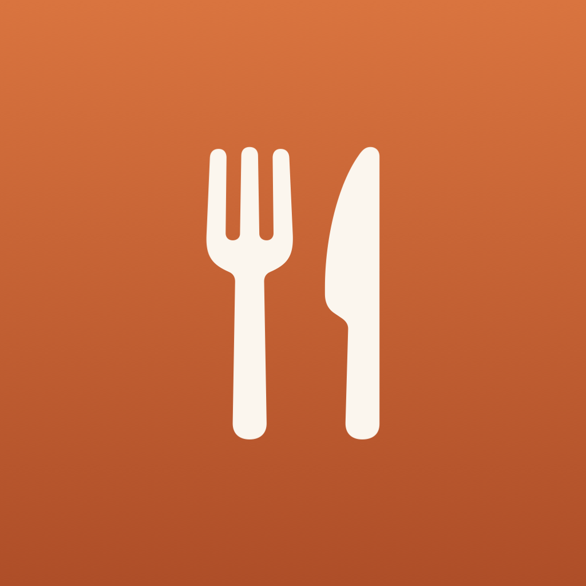
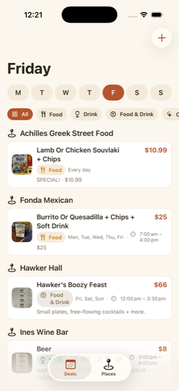
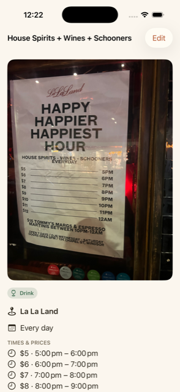
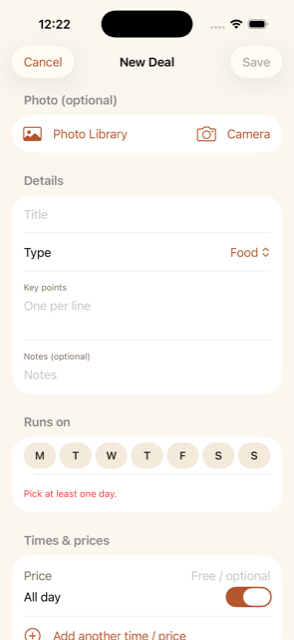

<div align="center">



# DealBoard

**A personal, offline-first iOS app for tracking daily food & drink deals near you.**

Browse by weekday, snap a photo of a deal board and let on-device text recognition
fill in the details, and see every venue's specials grouped in one tidy view.
No accounts, no ads, no analytics — completely free and offline-first, with
**optional** cloud sharing so friends can follow the same board with a code.

*Personal use only — not intended for the App Store.*

</div>

## Demo

<table>
  <tr>
    <td width="33%"></td>
    <td width="33%"></td>
    <td width="33%"></td>
  </tr>
  <tr>
    <td align="center"><b>Browse by day</b><br/>Venues grouped, each with its deals underneath.</td>
    <td align="center"><b>Combined deals</b><br/>Repeated windows roll up — here, a price for every hour.</td>
    <td align="center"><b>Add from a photo</b><br/>OCR fills in the title & details; every field editable.</td>
  </tr>
</table>

## Why it exists

Bars and restaurants run the same deals every week — Taco Tuesday, half-price
wine Wednesday, a happy hour that steps up in price every hour. DealBoard keeps
them all in one place so you can open the app, tap a day, and instantly see
who's got what on tonight.

## Features

- **Weekday browser** — pick a day (defaults to today), see every recurring deal,
  filter by Food / Drink / Food & Drink / Other.
- **Grouped by venue** — each place appears once with its specials, and all its
  deals for the day listed underneath. Filters still narrow to individual deals.
- **Add from a photo** — pick from your library or shoot live; on-device Vision
  OCR extracts the text and suggests an editable title and key points.
- **Smart establishment matching** — reads a photo's GPS to suggest the nearest
  saved place, and (online) nearby food & drink businesses from Apple Maps, so a
  deal lands at the right venue without typing.
- **Combined deals** — repeated versions of the same deal on the same night roll
  into one entry. If the price changes by time, each window shows its own price
  (*"$5 · 5–6pm, $6 · 6–7pm…"*).
- **Multiple time windows & prices**, an **All day** option, and a **6am day
  boundary** so late-night deals belong to the right night.
- **Manual entry everywhere** — every automated step has a by-hand fallback.
- **Optional cloud sharing** — create a board, share a code, and friends see and
  sync the same deals (backed by Supabase; off by default — see below).
- Warm, appetising design with full **Dark Mode**, **Dynamic Type**, and VoiceOver
  support.

## Offline-first

Everything core works with **no internet**: saving deals, establishments and
photos, and browsing which places have deals on a given day. All data lives in a
local [SwiftData](https://developer.apple.com/documentation/swiftdata) store;
photos are saved to the app's Documents directory.

Only two features use the network, and both are optional:

- **Establishment enrichment**: an Apple Maps place lookup at a photo's location. It never blocks the app. When you're offline it falls back to nearby saved places and manual entry, and nothing else breaks.
- **Cloud sharing**: off unless you configure it (see [below](#cloud-sharing-optional)).

There are no accounts and no analytics.

## Build & run

Requires **Xcode 16+** (built with Xcode 26.5), targets **iOS 17+**.

```sh
open DealBoard.xcodeproj
```

Pick an iPhone simulator and press ⌘R.

### On your own iPhone

1. Plug in your iPhone and select it as the run destination.
2. In the **DealBoard** target → **Signing & Capabilities**, set **Team** to your
   personal Apple ID (add it under Xcode ▸ Settings ▸ Accounts if needed) and, if
   the bundle id is taken, change it.
3. Press ⌘R. On first run, trust the certificate on the phone under
   **Settings ▸ General ▸ VPN & Device Management**, then run again.

## Project structure

```
DealBoard/
  DealBoardApp.swift        App entry + TabView root (Deals / Places)
  Models/                   SwiftData models, enums, time slots, preview data
  Services/                 OCR (Vision), photo GPS (ImageIO), place matching
                            (MapKit/CoreLocation), image storage, deal combining
  Views/                    SwiftUI screens + components
  Theme/Theme.swift         Warm semantic colours (light + dark variants)
  Resources/Assets.xcassets App icon
```

## Cloud sharing (optional)

DealBoard can share a board with friends: one person creates a board, gets a
short code, and anyone who enters that code sees and syncs the same deals. It's
**entirely optional** — with no setup the app stays 100% offline and unchanged.

It's backed by a free [Supabase](https://supabase.com) project (the only cloud
dependency). To enable it:

1. Create a free Supabase project.
2. In the Supabase **SQL editor**, run [`docs/supabase-setup.sql`](docs/supabase-setup.sql)
   to create the tables.
3. Copy `DealBoard/Resources/Supabase.example.plist` to `Supabase.plist` (same
   folder) and fill in your project **URL** and public **anon key** (Project
   Settings ▸ API). `Supabase.plist` is gitignored so your keys aren't committed.
4. Build & run. Tap the **people** icon on the home screen → *Create a shared
   board* or *Join with code*.

**How sync works:** per-record, last-write-wins on each deal's `updatedAt`, so two
people adding different deals both keep them. Syncs on app open, after edits, and
via *Sync now*.

**Limitations (v1):** photos aren't synced yet (they stay on each device); there's
no live/push updating (it syncs on open / on demand); and the group code is a light
gate, not real security — anyone with the app's anon key could query other codes,
so don't store anything sensitive. See the notes in the SQL file.

## Dependencies

Apple frameworks only for everything core — SwiftUI, SwiftData, Vision, PhotosUI,
ImageIO, CoreLocation, MapKit, UIKit. The optional cloud-sharing feature talks to
Supabase over plain `URLSession` (no SDK).

## Backing up / moving to another phone

Unless you set up cloud sharing, your deals live only on your device (and even with sharing, photos aren't synced). To copy everything
(deals, places and photos) to another phone, use Xcode's **Window ▸ Devices and
Simulators**: select the app, **Download Container…** from one phone, then
**Replace Container…** onto the other. Keep that `.xcappdata` file as a backup.
